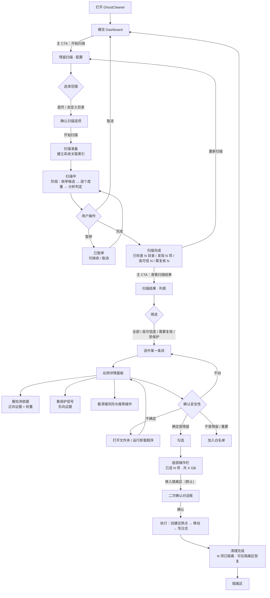
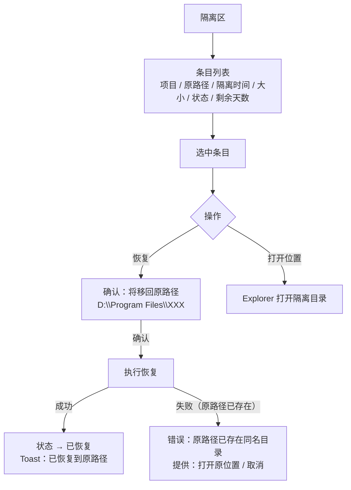
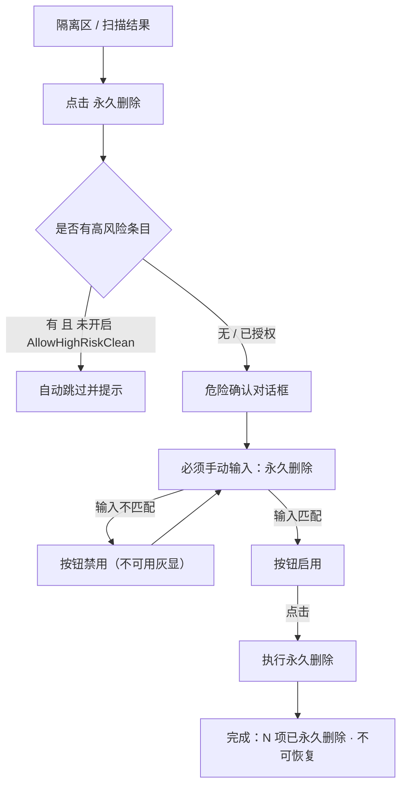
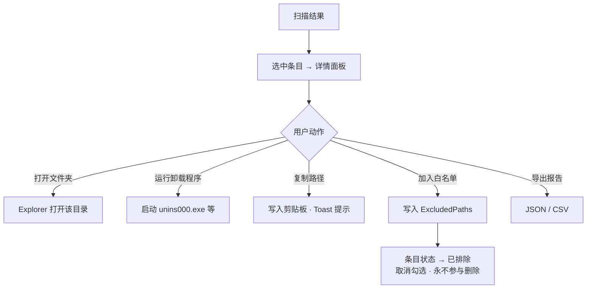
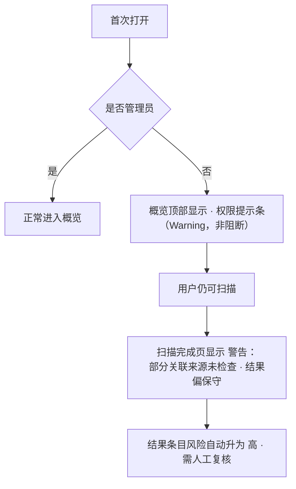
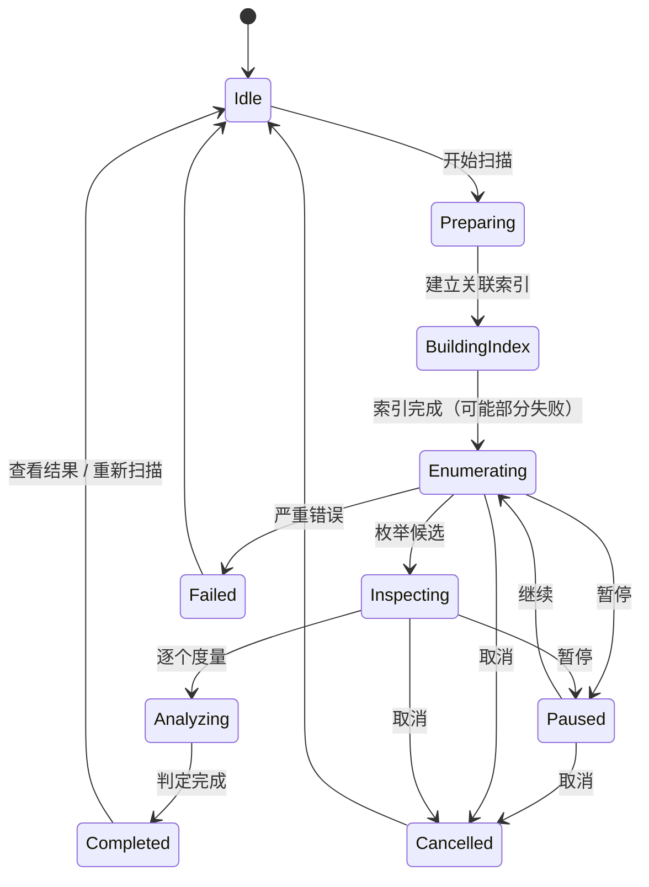

# Phase 5 — 用户流程（User Flow）

## 流程 1（主流程，必须完整）：一次完整的残留处理

### 流程 1 的关键设计约束

| 节点 | 约束 |
|---|---|
| 扫描准备 → 扫描中 | 必须让用户知道「正在建立系统关联索引」，因为这一步决定了结果可不可信 |
| 扫描中 | 必须同时显示：当前路径、百分比、**已检查目录数**、**已发现候选数**、已用时间；必须能暂停和取消 |
| 扫描完成 | 必须明确「高可信度 N」与「需要复核 N」两个数字分开显示，不得合并成一个总数 |
| 结果列表 | 默认**全部未勾选** |
| 详情面板 | 正向证据与保护信号**必须分区展示**，不能混在一个列表里 |
| 二次确认 | 必须显示：条目数、总大小、动作后果（可恢复 / 不可恢复） |
| 清理完成 | 必须告知「可在隔离区恢复」，并给出直达入口 |

---

## 流程 2：从隔离区恢复

| 节点 | 约束 |
|---|---|
| 恢复确认 | 必须显示**完整原路径**，用户要能确认会回到哪里 |
| 恢复失败 | 必须说明失败原因，并提供「打开原位置」让用户自己处理 |
| 恢复成功 | 条目不立即消失，状态变为「已恢复」，可筛选隐藏 |

---

## 流程 3：永久删除（最高危）

| 节点 | 约束 |
|---|---|
| 确认文字 | 必须与 `CleanupService.PermanentDeleteConfirmText` 一致（现状：*永久删除*） |
| 按钮状态 | 输入不匹配时**禁用**，不是点击后报错 |
| 配色 | 整个对话框使用 Danger 色系，但**只在按钮与图标上**，背景保持中性 |
| 文案 | 必须明确「不可恢复」 |

---

## 流程 4：结果详情 → 打开 / 白名单

| 节点 | 约束 |
|---|---|
| 加入白名单 | 必须立即在列表上反馈（状态徽章变化 + 取消勾选），并且提示「可在设置 → 保护与白名单 中移除」 |
| 打开文件夹 | 若目录已不存在，按钮禁用并说明原因 |

---

## 流程 5（补充）：首次启动 / 权限不足

> **设计原则：权限不足不阻断，但必须持续可见地告知。** 这比弹一个"请以管理员身份重启"的模态框更有用。

---

## 6. 状态机：扫描流程

> `Paused` 与 `BuildingIndex / Enumerating / Inspecting / Analyzing` 阶段需要 Core 提供（`UDR-01` / `UDR-05`）。UI 0.1 设计已完成，Core 未就绪前 UI 0.2 可先降级为「准备 → 扫描中 → 完成」三态。
